# tessera

Procedural generation tools for [Nelson](https://nelson-lang.github.io/nelson-website/).

`tessera` provides generators for noise, fractals, terrain, cellular patterns,
sampling and structure synthesis. The native kernels are written in portable C++
and do not depend on third-party libraries. Public functions are exposed under
the `tessera.` namespace.

```nelson
run('loader.m')
R = tessera.mandelbrot(800, 300);
imagesc(R); axis image off; colormap(tessera.colormap('fire'))
```

## Gallery

| | | |
| :---: | :---: | :---: |
| 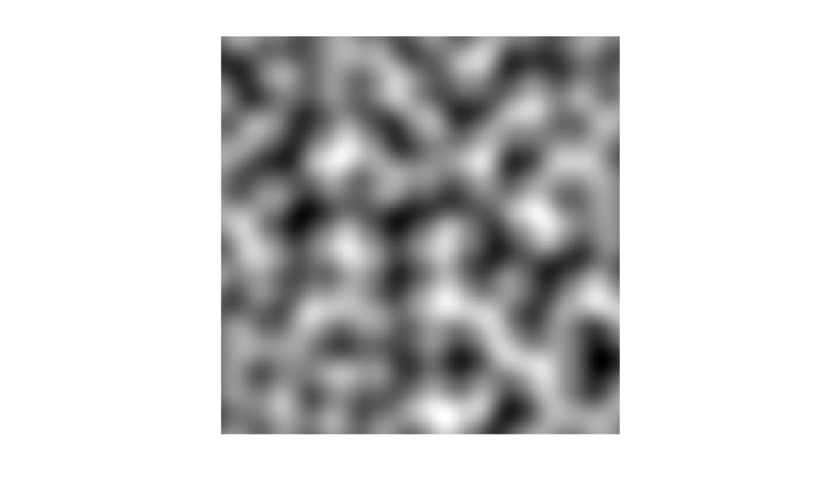<br>Perlin noise | 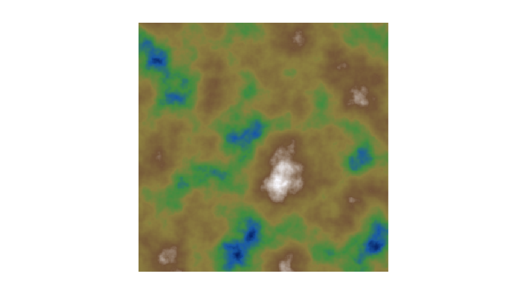<br>fBm terrain | 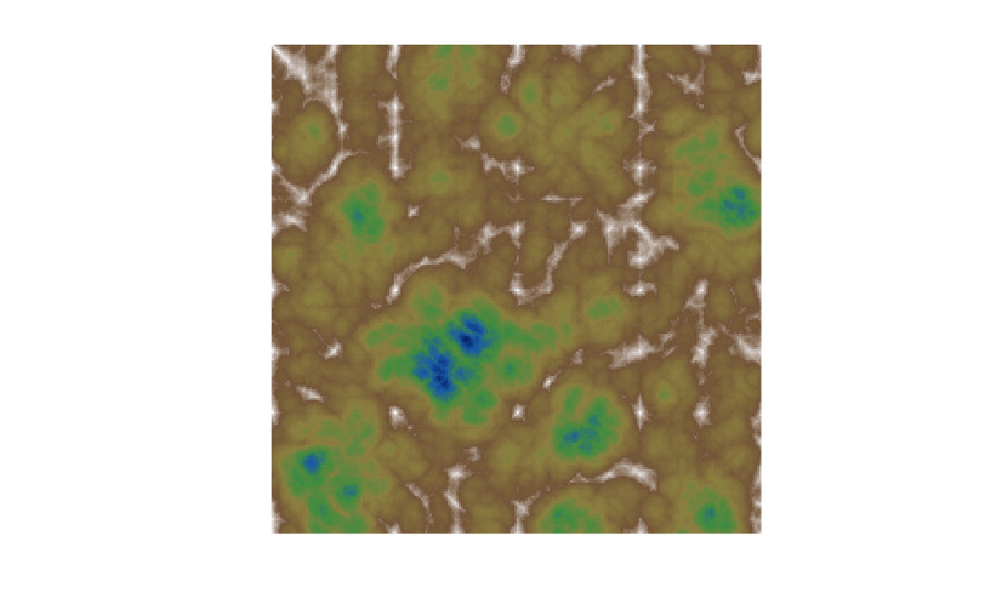<br>ridged multifractal |
| 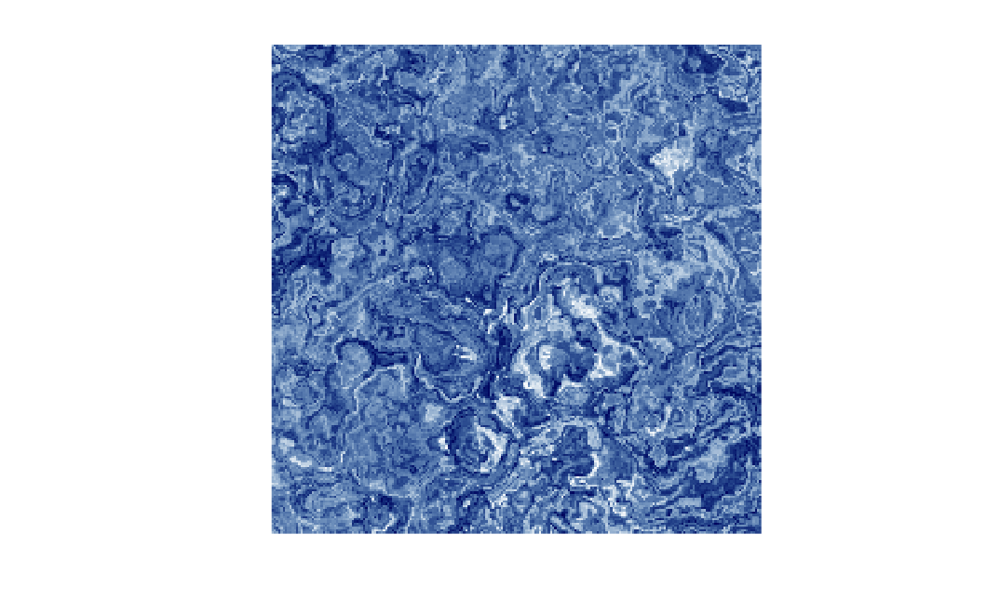<br>domain warp | 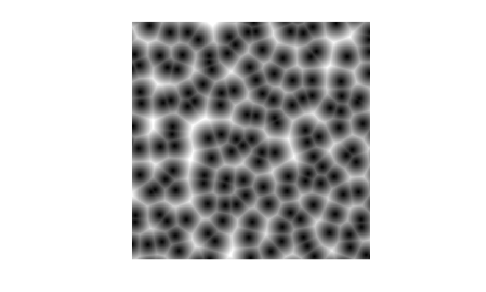<br>Worley cells | 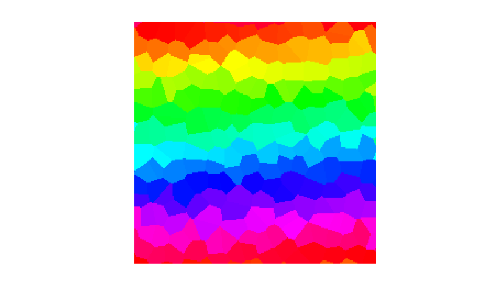<br>Voronoi regions |
| 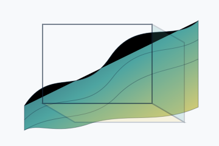<br>3-D fBm slices | 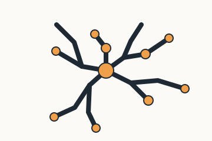<br>DLA cluster | 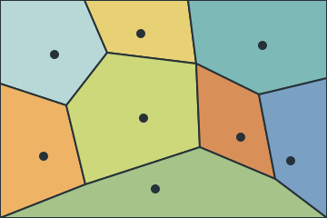<br>Lloyd relaxation |
| 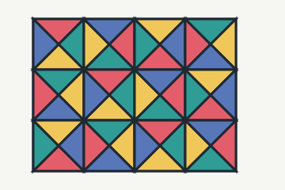<br>Wang tiles | 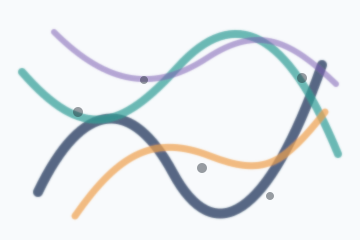<br>Gabor noise | 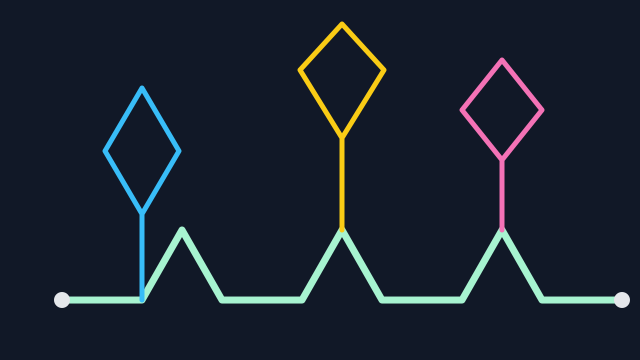<br>L-system turtle |
| 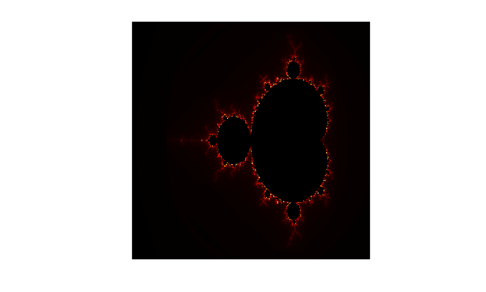<br>Mandelbrot | 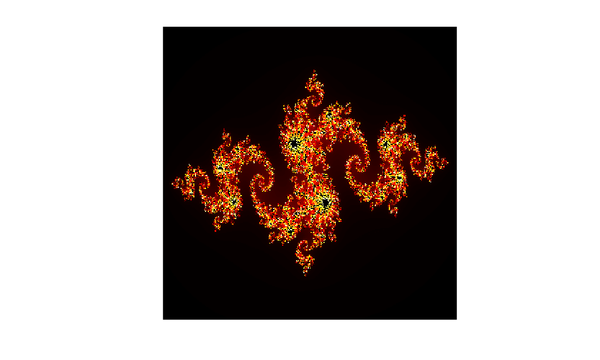<br>Julia | 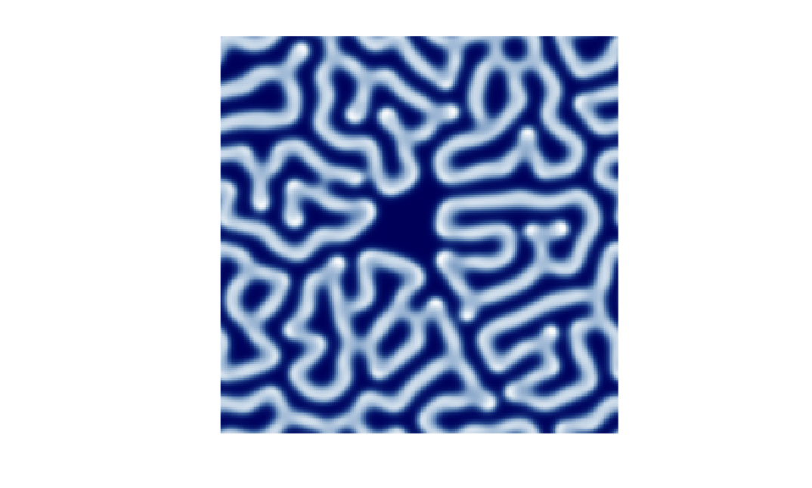<br>reaction-diffusion |
| 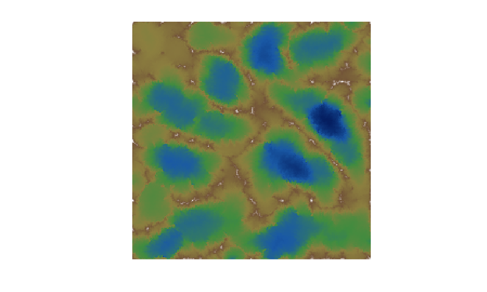<br>hydraulic erosion | 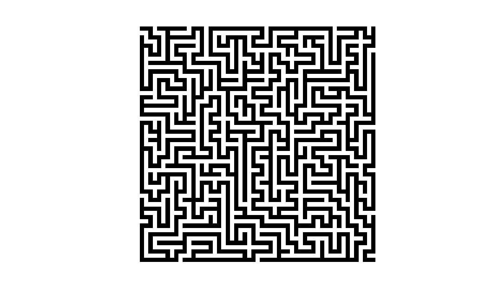<br>maze | 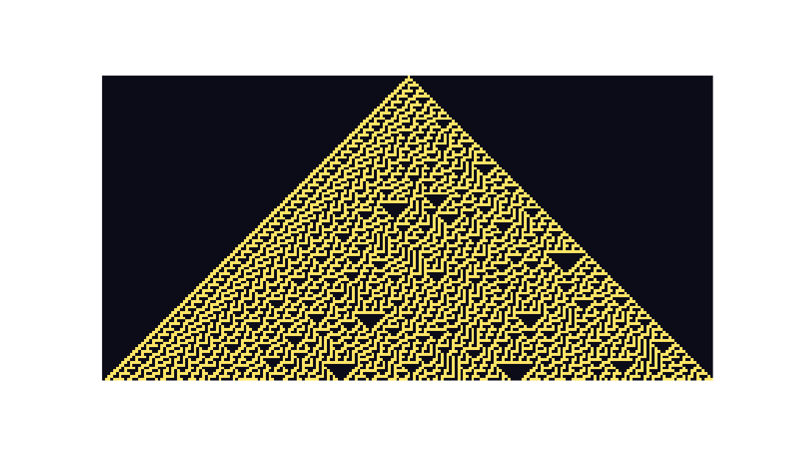<br>rule 30 automaton |

## Load And Build

Load the module from a checkout:

```nelson
run('loader.m')
```

Unload it from the current Nelson session:

```nelson
removemodule('tessera')
```

Rebuild the native gateway and help files from source:

```nelson
run('builder.m')
```

A C/C++ compiler is required for `builder.m`.

## Data Conventions

Noise fields are normalized to `[0, 1]`. Size arguments use these forms:

- `sz`: scalar square field
- `[rows cols]`: 2-D field
- `[rows cols planes]`: 3-D volume

Main noise functions accept their positional form and name-value options such as
`'frequency'`, `'lacunarity'`, `'gain'`, `'seed'` and `'seamless'`.

## API

### Coherent Noise

| Function | Description |
| --- | --- |
| `tessera.perlin(sz, frequency, seed)` | Perlin gradient noise. Options: `'frequency'`, `'seed'`, `'seamless'`. |
| `tessera.simplex(sz, frequency, seed)` | Simplex noise. Options: `'frequency'`, `'seed'`, `'seamless'`. |
| `tessera.perlin3(sz, frequency, seed)` | 3-D Perlin volume. |
| `tessera.simplex3(sz, frequency, seed)` | 3-D simplex volume. |
| `tessera.value_noise(sz, frequency, seed)` | Value noise. |
| `tessera.worley(sz, cells, seed)` | Worley noise. Options: `F1`, `F2`, `F2-F1`, `euclidean`, `manhattan`, `chebyshev`, `seamless`. |
| `tessera.gabor_noise(sz, impulses, frequency, seed)` | Sparse Gabor-kernel noise. Also accepts `'impulses'`, `'frequency'` and `'seed'`. |
| `tessera.wavelet_noise(sz, octaves, seed)` | Band-pass wavelet-style octave noise. Also accepts `'octaves'` and `'seed'`. |

### Fractal Noise

| Function | Description |
| --- | --- |
| `tessera.fbm(sz, octaves, seed)` | Fractional Brownian motion. Options: `'frequency'`, `'lacunarity'`, `'gain'`, `'seed'`, `'seamless'`. |
| `tessera.fbm3(sz, octaves, seed)` | 3-D fractional Brownian motion. |
| `tessera.ridged(sz, octaves, seed)` | Ridged multifractal. |
| `tessera.billow(sz, octaves, seed)` | Billow noise. |
| `tessera.turbulence(sz, octaves, seed)` | Absolute-value fBm. |
| `tessera.domain_warp(sz, octaves, strength, seed)` | Domain-warped fBm. |

### Escape-Time Fractals

These functions return a smooth iteration count. `0` means the point did not
escape during the configured iteration budget.

| Function | Description |
| --- | --- |
| `tessera.mandelbrot(sz, maxiter, region)` | Mandelbrot set. |
| `tessera.julia(sz, c, maxiter, region)` | Julia set, with `c` as a complex value or `[re im]`. |
| `tessera.burningship(sz, maxiter, region)` | Burning Ship fractal. |
| `[root, iter] = tessera.newton(sz, maxiter, region)` | Newton fractal for `z^3 - 1`. |

`region` is `[xmin xmax ymin ymax]`.

### Terrain

| Function | Description |
| --- | --- |
| `tessera.diamond_square(n, roughness, seed)` | `(2^n+1)` by `(2^n+1)` heightfield. Supports `'seamless'`. |
| `tessera.erode(heightfield, droplets, seed)` | Hydraulic erosion pass on an existing heightfield. |

### Cellular Patterns

| Function | Description |
| --- | --- |
| `tessera.gameoflife(grid, generations)` | Conway's game of life on a toroidal grid. |
| `tessera.automaton1d(rule, width, generations, init)` | Elementary one-dimensional cellular automaton. |
| `tessera.reaction_diffusion(sz, steps, feed, kill, seed)` | Gray-Scott reaction-diffusion pattern. |

### Structure Generation

| Function | Description |
| --- | --- |
| `tessera.voronoi(sz, cells, seed)` | Voronoi cell-id map. |
| `[R, sites] = tessera.lloyd(sz, cells, iterations, seed)` | Voronoi cell-id map and final site coordinates after Lloyd relaxation. |
| `tessera.cave(sz, fill, steps, seed)` | Cellular-automaton cave, where `1` is wall and `0` is floor. |
| `tessera.maze(rows, cols, seed)` | Recursive-backtracker maze. |
| `tessera.chaos_game(n, kind, seed)` | IFS points for `'fern'` or `'sierpinski'`. |
| `tessera.lsystem(axiom, rules, iterations)` | Expand an L-system string. |
| `tessera.turtle(commands, angle, step)` | Convert turtle commands into polyline coordinates. |
| `[P, W, C] = tessera.turtle_render(...)` | Turtle coordinates with per-symbol step, width and color parameters. |
| `tessera.dla(sz, particles, seed, ...)` | Diffusion-limited aggregation with obstacles, multiple seeds, directional attraction and periodic borders. |
| `tessera.wang_tiles(sz, colors, seed)` | Wang tile ids with matching neighbor edges. Also accepts `'colors'` and `'seed'`. |
| `tessera.tile_wfc(sample, outsize, seed)` | Tiled-model synthesis from sample adjacency. |
| `[R, info, trace] = tessera.wfc(sample, outsize, N, seed)` | Overlapping-model wave function collapse with retry, contradiction and decision diagnostics. |

### Flow And Image Helpers

| Function | Description |
| --- | --- |
| `tessera.advect_curl(points, steps, ...)` | Advect normalized particle positions through curl noise. |
| `tessera.rgb_volume(volume, cmap)` | Convert a 3-D scalar volume to RGB. |
| `tessera.rgb_sequence(frames, cmap)` | Convert a 3-D scalar frame sequence to RGB frames. |

### Sampling

| Function | Description |
| --- | --- |
| `tessera.poisson_disk(width, height, radius, k, seed)` | Bridson Poisson-disk samples. |
| `tessera.halton(n, dims)` | Halton low-discrepancy sequence. |

### Helpers And Demos

| Function | Description |
| --- | --- |
| `tessera.colormap(name, n)` | Procedural colormaps: `terrain`, `fire`, `ice`, `grayscale`. |
| `tessera.rgb(field, cmap)` | Convert a scalar field to an RGB image. |
| `tessera.animate(kind, frames, ...)` | Animation helper with `frames`, `size`, `palette`, `seed` and GIF `output` options. Kinds include `julia`, `mandelbrot_zoom`, `life`, `reaction`, `fbm3_slice`, `worley_edges`, `turtle`, `curl_particles`, `dla_growth`, `lloyd_relaxation`, `gabor_sweep`, `wavelet_sweep` and `wang_scroll`. |
| `tessera.demo()` | Static generator gallery. |

## Examples

Terrain field:

```nelson
H = tessera.ridged(512, 7, 42);
imagesc(H); axis image off; colormap(tessera.colormap('terrain'))
```

Tileable 3-D fBm volume:

```nelson
V = tessera.fbm3([128 128 32], 'octaves', 5, 'seed', 42, 'seamless', true);
imagesc(V(:, :, 1)); axis image off
```

Worley edge texture:

```nelson
W = tessera.worley(256, 'cells', 12, 'feature', 'f2-f1', ...
  'metric', 'chebyshev', 'seamless', true);
imagesc(W); axis image off; colormap(tessera.colormap('fire'))
```

L-system coordinates:

```nelson
S = tessera.lsystem('F', {'F', 'F+F--F+F'}, 3);
P = tessera.turtle(S, 60, 1);
plot(P(:, 1), P(:, 2)); axis equal off
```

Animated examples:

```nelson
tessera.animate('fbm3_slice', 96)
tessera.animate('worley_edges', 120)
tessera.animate('turtle', 180)
tessera.animate('dla_growth', 90)
tessera.animate('lloyd_relaxation', 80)
tessera.animate('gabor_sweep', 120)
tessera.animate('wavelet_sweep', 'frames', 120, 'size', 192, ...
  'palette', 'ice', 'seed', 3, 'output', 'wavelet.gif')
tessera.animate('curl_particles', 'frames', 160, 'size', 180, 'seed', 9)
tessera.animate('wang_scroll', 120)
```

RGB output:

```nelson
H = tessera.fbm(256, 'seed', 1);
RGB = tessera.rgb(H, 'terrain');
imshow(RGB)
```

## Tests

```nelson
test_run('tessera')
```

## License

LGPL-3.0-or-later. Copyright (c) 2016-present Allan CORNET (Nelson).
